<a href="https://siddharthgeddam.dev">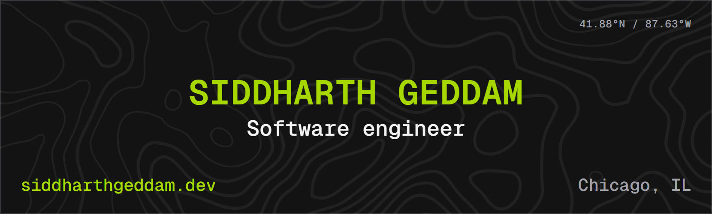</a>


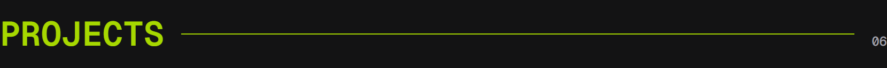

<a href="https://siddharthgeddam.dev/projects/signpose-vr">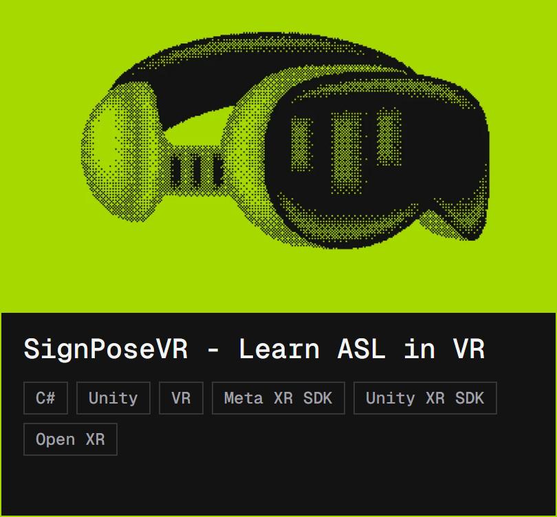</a>
<a href="https://siddharthgeddam.dev/projects/confidential-ml-federated-learning">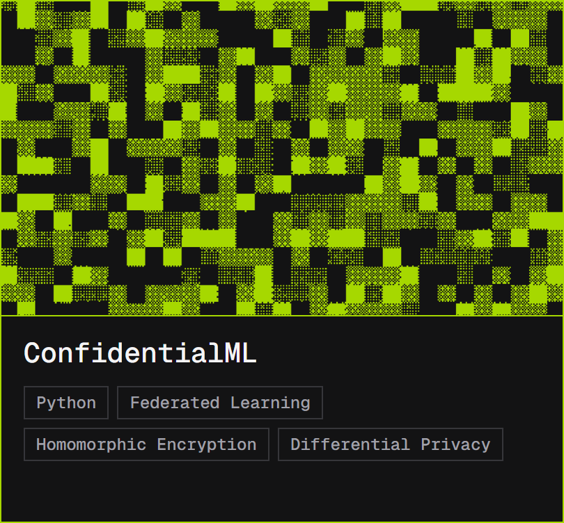</a>

<a href="https://siddharthgeddam.dev/projects/iit-campus-assistant">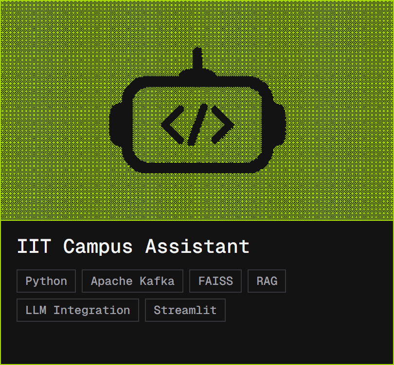</a>
<a href="https://siddharthgeddam.dev/projects/spatial-inequality-cook-county">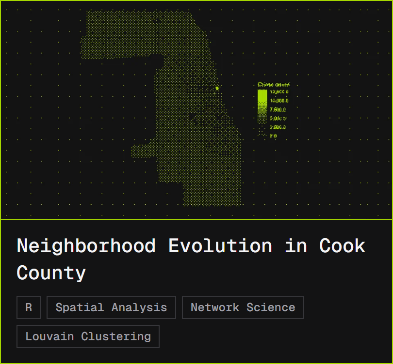</a>

<a href="https://siddharthgeddam.dev/projects/sidportfolio-engineering">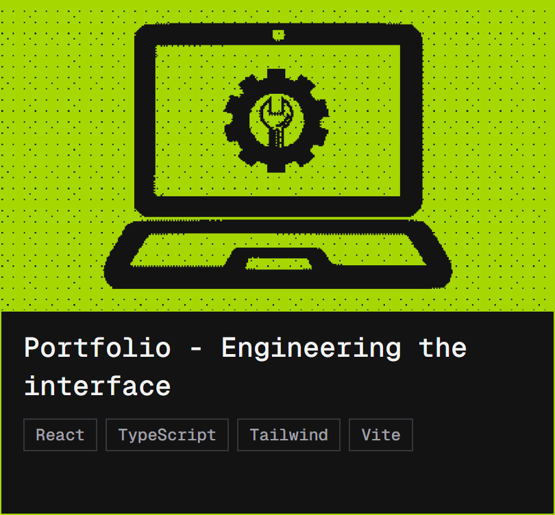</a>
<a href="https://siddharthgeddam.dev/projects/ieee-iit-style-guide">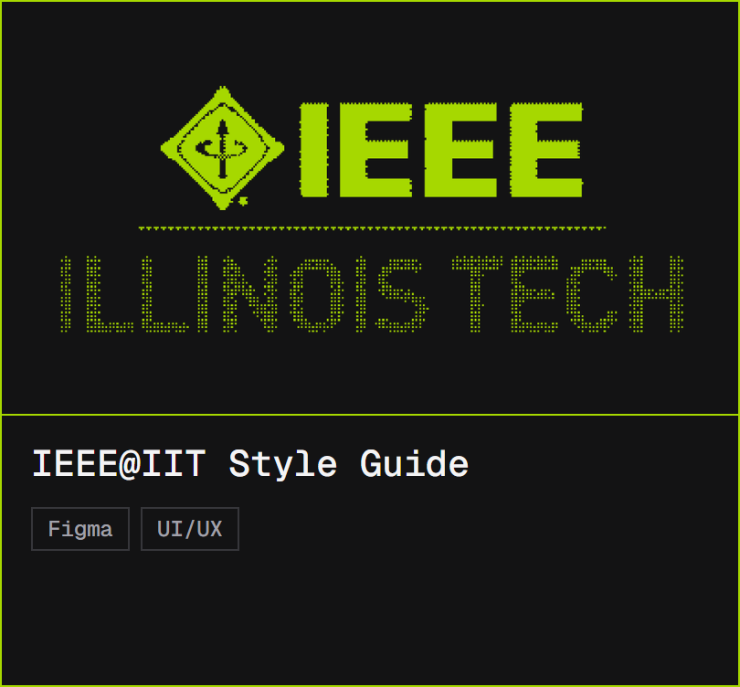</a>

Every card opens its full case study on <a href="https://siddharthgeddam.dev/projects">siddharthgeddam.dev</a>.

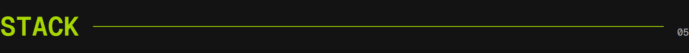

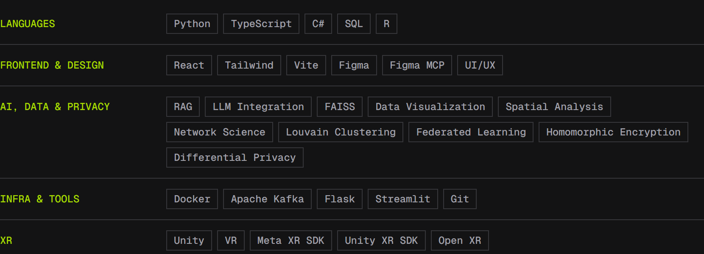

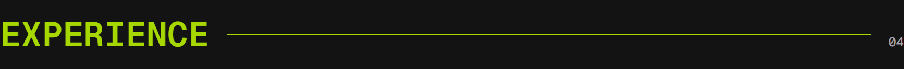

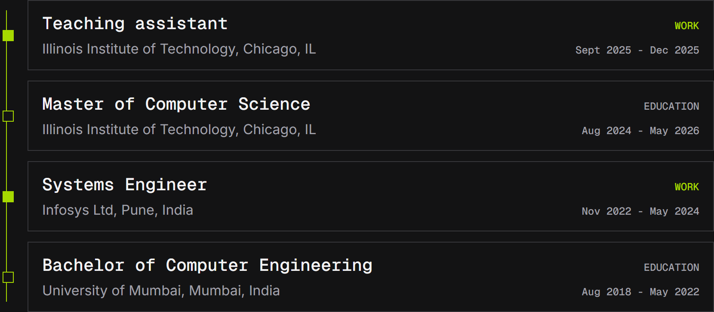

<a href="https://siddharthgeddam.dev">siddharthgeddam.dev</a> &middot;
<a href="https://www.linkedin.com/in/siddharth-geddam/">LinkedIn</a> &middot;
<a href="mailto:siddharthgeddam@gmail.com">Email</a>

This README shares one design system with my site and LinkedIn banner. <a href="https://siddharthgeddam.dev/projects/sidportfolio-design">See how it was built.</a>

